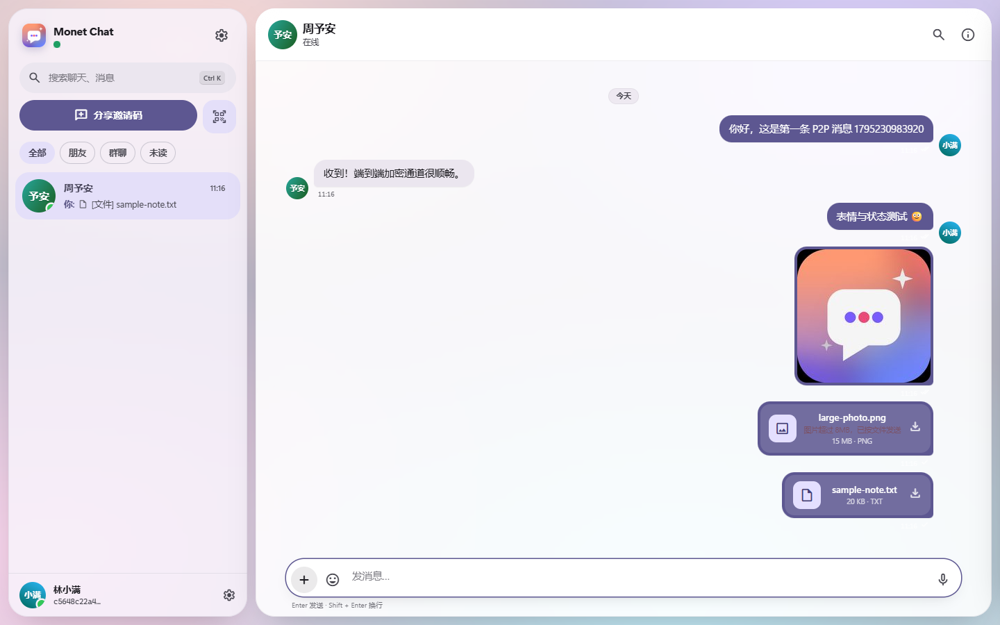
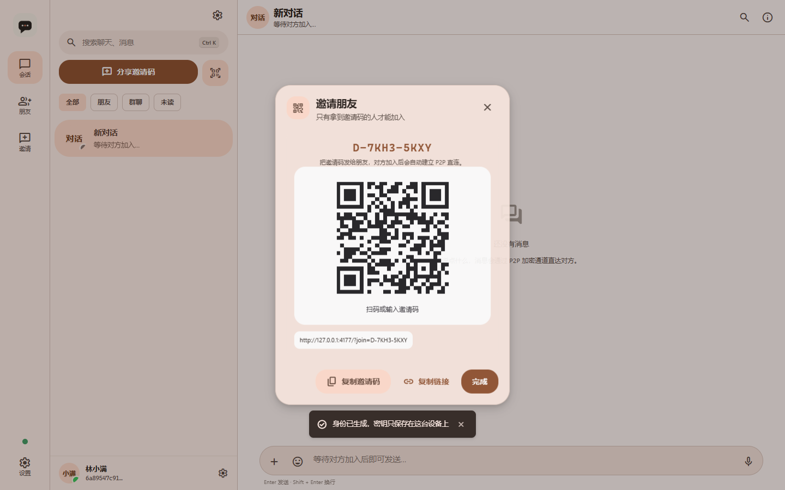
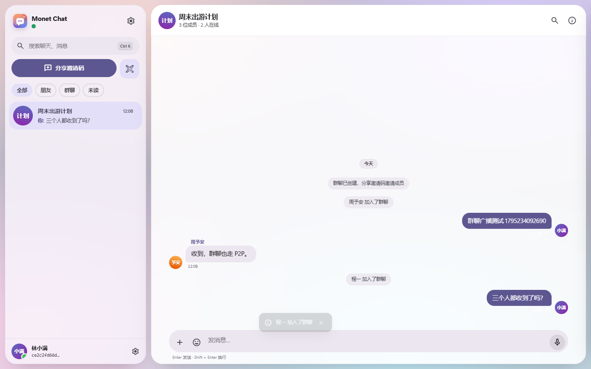
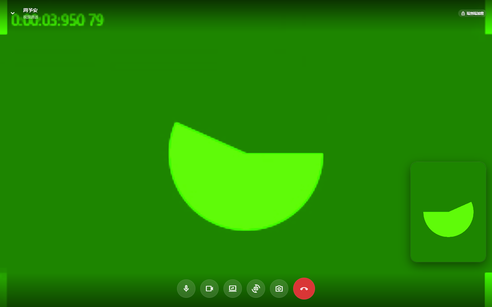
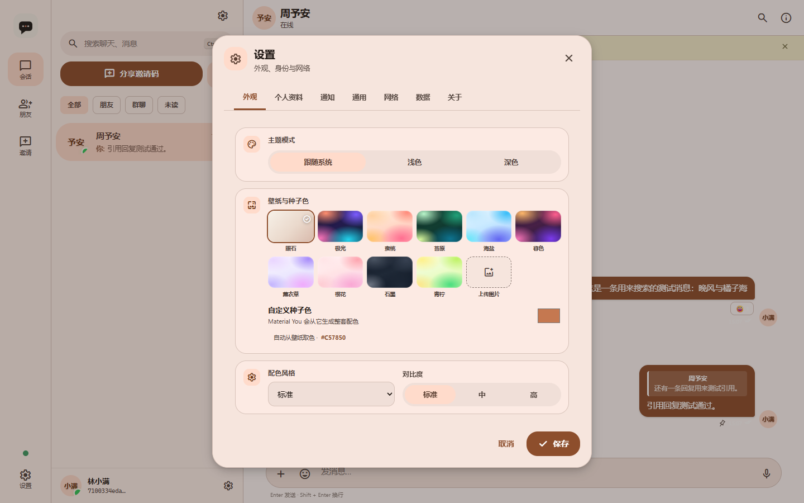

# Monet Chat

以 **P2P 直连** 为核心、端到端加密、Google **Material You / Monet** 动态取色的全平台聊天应用。同一套代码可运行在 Android APK、Windows EXE、Linux 便携包和可安装 PWA 中；macOS/iOS 工程已就绪，需在 Mac 上签名构建。

没有账号，没有中心化消息存储；服务器只负责交换 SDP/ICE 和房间成员，聊天内容不经过服务器。

> 源码仓库：<https://github.com/9527-tech/monet-chat>（仓库已创建；因 GitHub 要求 2FA/密码重新验证，代码尚未推送，本地 `main` 已提交）



| 邀请 | 群聊 | 视频通话 | 取色设置 |
| --- | --- | --- | --- |
|  |  |  |  |

## 功能

- **P2P 私聊 / 群聊**：WebRTC mesh；私聊 2 人、群聊最多 12 人；按身份 ID 确定性决定谁发 offer，避免 glare。
- **固定朋友列表**：联系人独立持久化到 IndexedDB `peers`。对方离线、换网络、关掉页面都不会从列表消失；重新上线自动重连并补发消息。
- **端到端加密**：
  - 每台设备生成 ECDSA P-256 签名密钥 + ECDH P-256 协商密钥，身份 ID = 公钥指纹。
  - 资料卡由私钥签名，加入房间时校验签名与 `ecdhPub`，防止中间人替换资料。
  - 每对设备用 ECDH + HKDF-SHA256 派生独立 AES-256-GCM 会话密钥；文字、文件、通话信令全部加密。
  - 私聊信息面板显示 12 组 5 位安全码，可与对方当面或另开渠道比对。
- **照片直收，文件需确认**：≤ 8MB 的图片自动接收并内联显示；更大的图片改判为文件，任何文件都要对方点“点击接收”才开始传输，避免陌生人用大文件塞满设备。
- **完整消息能力**：文字、表情、图片（压缩 + 缩略图 + 灯箱）、任意文件（分片 + 进度 + 完整性校验）、语音条、回复、编辑、撤回、删除、表情回应、置顶、已读回执、正在输入、未读数、全局与会话内搜索、无限上翻、导出聊天记录。
- **语音 / 视频通话**：WebRTC 音频、视频、屏幕共享、静音、关摄像头、前后摄像头切换、截图、通话记录；来电界面、45 秒振铃超时。
- **简单模式（默认）**：外面只看到“分享一个码，就能聊天”；通话、安全码、群聊入口、平台说明等高级能力收进设置与信息面板。设置里可关闭简单模式。
- **远程模式**：EXE 内置 Cloudflare Quick Tunnel 入口，可生成公网 HTTPS 链接，跨网络邀请；同一 Wi-Fi 下仍可直接用局域网 IP。公网隧道依赖 Cloudflare，网络不通时会明确提示，不假装成功。
- **Material You 取色**：
  - 9 套渐变壁纸 + 自定义图片壁纸；
  - 8 种 MCU 配色风格（Tonal Spot / Vibrant / Expressive / Content / Fidelity / Neutral / Monochrome / Fruit Salad）；
  - 标准 / 中 / 高对比度；浅色 / 深色 / 跟随系统；启动前用缓存色板避免闪白。
- **全平台 PWA**：可安装到 Windows / macOS / Linux / Android / iOS 主屏幕；Service Worker 缓存应用外壳，离线可打开；manifest 快捷方式“新对话 / 加入会话”。
- **本地优先**：IndexedDB 保存身份、会话、消息、文件；身份备份可导出 / 导入 JSON；清空数据前有二次确认。
- **移动端适配**：手机单栏、平板双栏、桌面三栏；底部安全区、移动端底部弹层、消息区与输入框避让键盘。

## 原生安装包

`release/` 内是可直接安装的成品：

| 文件 | 平台 | 说明 |
| --- | --- | --- |
| `MonetChat-1.1.0.apk` | Android 6.0+ | 已签名 release APK；edge-to-edge 全屏，手机单栏 / 平板双栏自动切换 |
| `MonetChat-Setup-1.1.0.exe` | Windows 10/11 x64 | NSIS 安装版；双击安装，创建桌面与开始菜单快捷方式 |
| `MonetChat-Portable-1.1.0.exe` | Windows 10/11 x64 | 免安装便携版；双击即用 |
| `MonetChat-1.1.0-linux-x64.tar.gz` | Linux x64 | 解压后 `chmod +x monet-chat && ./monet-chat` |

macOS 与 iOS 的原生包必须在 Mac + Xcode 上构建和签名，Windows 无法完成；工程与步骤见 [`macos/README.md`](macos/README.md)、[`ios/README.md`](ios/README.md)。不构建原生包时，Safari/Chrome 的“添加到主屏幕”PWA 覆盖这两个平台。

### 手机 / 平板首次使用

1. 在 Windows 上安装或打开 Monet Chat EXE，它会同时启动内置信令服务（默认 `http://<本机局域网 IP>:4173`）。
2. 手机和平板连接 **同一个 Wi-Fi**，在 APK 首次启动的“信令服务器”里填写 `http://<Windows 局域网 IP>:4173`。
3. 允许 Windows 防火墙对 Monet Chat 的专用网络访问；否则手机无法加入房间。
4. 之后的邀请码、扫码、P2P 直连流程与网页版完全一致。

APK 使用 `viewport-fit=cover` + StatusBar overlay + `env(safe-area-inset-*)`，内容延伸到状态栏和手势条下方；宽度 ≤ 680dp 为手机单栏，681–1100dp 为平板双栏（侧栏 300dp），更宽为桌面三栏。

> APK 已用 `android/monet-release.jks` 签名；该密钥和密码仅用于本次交付。EXE 未购买代码签名证书，Windows SmartScreen 可能提示“未知发布者”，选择“更多信息 → 仍要运行”。

### 跨网络（“很远很远”）

- 方式一：在 EXE 的 **设置 → 网络 → 公网远程通道** 点“启动远程通道”，等待 10–30 秒生成 `https://xxx.trycloudflare.com`，再在邀请弹窗里复制“公网链接”。
- 方式二：把 `server.mjs` 部署到有公网 IP 的 VPS，在 APK 首次启动时填写 `https://你的域名`；建议配 Caddy/Nginx 自动 HTTPS。
- 跨网络时 WebRTC 仍需 STUN；对称 NAT / 企业网络请在设置里填 TURN。

## 快速开始

要求 **Node.js 20+**（开发时使用 Node 24）。

```bash
cd monet-chat
npm install
npm start
```

打开 <http://localhost:4173>。同一局域网的设备访问 `http://<你的局域网 IP>:4173`。

> `localhost` 属于安全上下文，可以直接使用麦克风、摄像头和 Service Worker。通过局域网 IP 访问时，浏览器通常要求 **HTTPS** 才允许 `getUserMedia` / PWA 安装。生产或手机测试建议用 Cloudflare Tunnel、Caddy、Nginx 等加一层 HTTPS。

### 两台设备互聊

1. A 点“分享邀请码” → 创建邀请码（或复制链接/扫码）。
2. B 打开链接，或点“加入会话”输入邀请码。
3. 双方进入同一房间后，WebRTC 自动协商，状态变为“在线 · P2P 直连”即可发消息。

群聊：点“新对话”→ “创建群聊”，把同一个邀请码发给最多 11 位成员。

### 网络与 TURN

默认使用 Google 公共 STUN。对称 NAT、企业防火墙或部分移动网络下直连可能失败，可在“设置 → 网络”填写 TURN：

```text
turn:turn.example.com:3478
用户名 / 密码
```

也可以设置独立的信令服务器地址（例如 `https://chat.example.com`）。信令服务器只转发 SDP/ICE，不接触聊天明文。

## 架构

```text
┌──────────┐  HTTPS / SSE + POST   ┌──────────────┐
│ Browser A │◄─────────────────────►│ server.mjs   │
└────┬─────┘   房间、SDP、ICE、在线状态  └──────┬───────┘
     │                                        │
     │      WebRTC DataChannel（加密）          │
     └────────────────────────────────────────┘
                      Browser B
```

- `server.mjs`：零依赖 Node HTTP 服务。内存房间（TTL 24h）、SSE 事件流、SDP/ICE 转发、静态文件、SPA 回退、可选 Cloudflare 隧道。
- `src/signaling.js`：SSE 信令客户端；房间加入/离开、资料更新、断线重连。
- `src/peer.js`：WebRTC mesh。每对 peer 两条有序通道：`monet-data`（JSON 帧）与 `monet-file`（分片帧）；48KB 分片、缓冲水位流控、队列、重连、文件完整性检查。
- `src/crypto.js`：身份、签名资料、ECDH + HKDF、AES-GCM。
- `src/db.js`：IndexedDB 封装（profile/settings/chats/messages/peers）。
- `src/theme.js`：MCU 取色与 CSS 变量；壁纸处理。
- `src/ui.js` / `src/render.js`：Material 3 组件（模态、菜单、Toast、灯箱、Emoji、二维码）与消息/列表/信息面板/通话渲染。
- `src/calls.js`：通话状态机、媒体流、屏幕共享、通话信令。
- `app.js`：应用编排（会话、消息、附件、设置、PWA、快捷键）。
- `electron/main.cjs`：Windows 壳，启动内置服务并加载界面。
- `android/`：Capacitor Android 工程。

### 加密细节

- 身份签名：ECDSA P-256；协商：ECDH P-256。
- 会话密钥：HKDF-SHA256，salt 包含双方排序后的 ID，info 绑定 `aes-256-gcm`。
- 每条消息随机 12 字节 IV；AES-256-GCM 认证加密。
- 文件分片独立加密，接收端校验分片齐全后重组；不完整会拒绝并提示重试。
- 私钥只存在本机 IndexedDB；导出身份备份时请当作密码保管。

## 构建

### 网页版

```bash
npm start
npm run test:all
```

`npm run test:all` 会依次跑双端文本/图片/文件、群聊、语音/视频、UI、搜索、设置、大小图策略、离线补发、PWA、平板/手机布局等 Playwright 场景（需要 Edge）。

### Android APK

需要 JDK 21 + Android SDK 35（本仓库开发环境在 `toolchain/`，已加入 `.gitignore`）。

```bash
npm run native:web
npm run native:sync
npm run android:release
```

输出：`android/app/build/outputs/apk/release/app-release.apk`。

### Windows EXE

```bash
npm run dist:win
```

输出：`dist/MonetChat-Setup-1.1.0.exe` 与 `dist/MonetChat-Portable-1.1.0.exe`。

## 测试

```bash
npm run test:all
npm run test:electron
npm run test:tablet
```

覆盖：双端文字/表情/图片/文件、群聊 3 人 fanout、音频/视频通话、搜索/回应/回复/置顶、资料同步、安全码、语音、编辑、删除、离线补发、PWA 离线、平板双栏/手机单栏、EXE 打包运行。

## 已知限制

- **P2P 不等于无服务器**：仍需信令服务器做房间发现与 NAT 穿透；消息与文件不经过服务器。
- **离线补发仅限当前页面生命周期**：双方都离线时没有第三方存储转发；需要真正离线消息请部署常驻中继。
- **群聊为全互联 mesh**：人数越多上行压力越大，上限 12 人。
- **静态 ECDH 无前向保密**：会话密钥由长期 ECDH 密钥派生；高安全场景建议后续加入双棘轮。
- **远程通道依赖 Cloudflare**：当前开发网络无法解析 Cloudflare Tunnel 的 SRV 记录，因此只能验证“失败提示”路径；网络正常的环境可直接使用。
- **EXE 未做代码签名**：SmartScreen 会提示未知发布者。
- **iOS**：PWA 对后台通话、通知和文件保存限制较多，建议用 Android/桌面。

## 隐私

- 服务器不保存消息、文件或联系人。
- 房间只在内存中保留 24 小时，进程重启即清空。
- 身份资料会广播给同房间成员；不会上传通讯录。
- 导出聊天记录 / 身份备份前请确认接收方可信。

## 许可

MIT，见 [LICENSE](LICENSE)。
